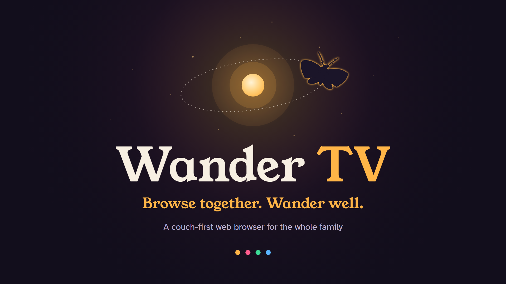
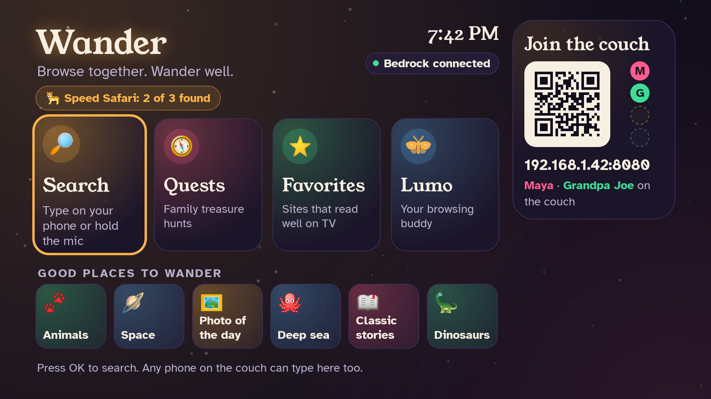
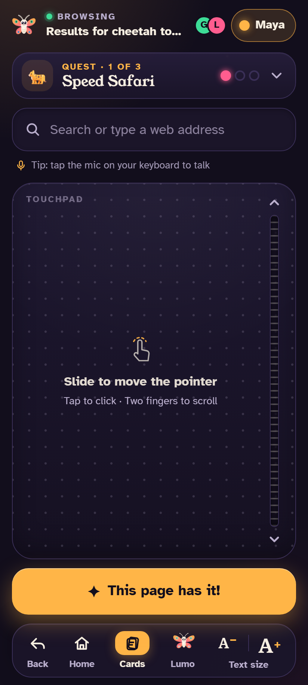
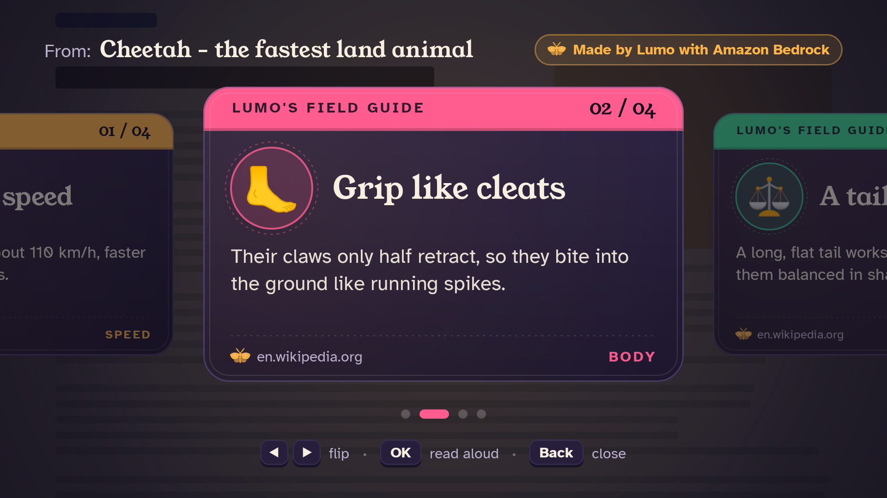
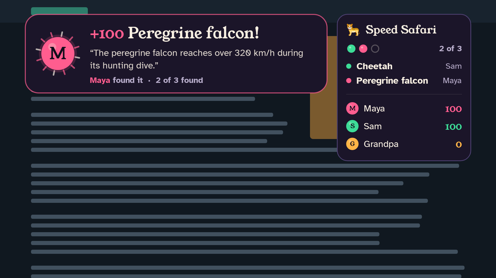
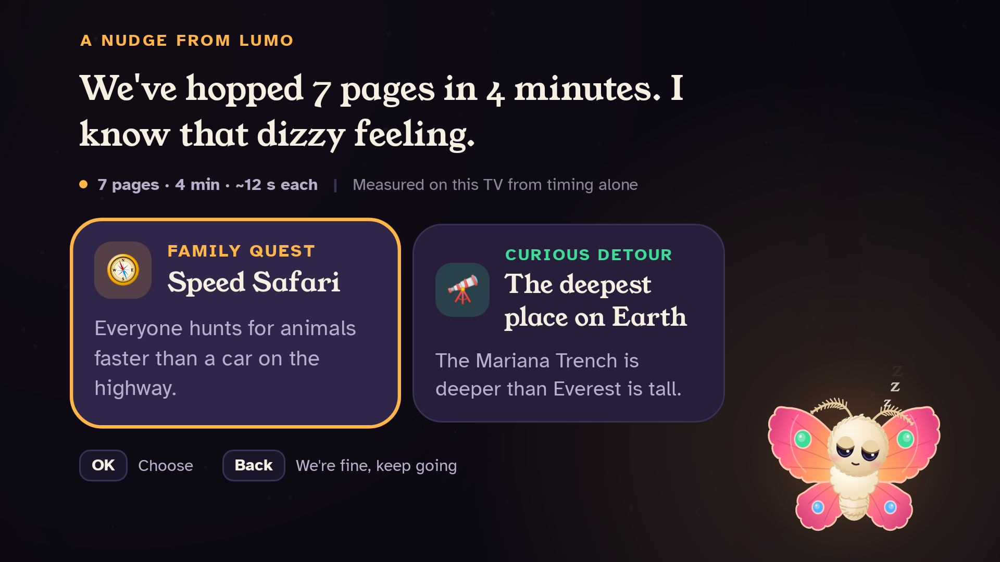
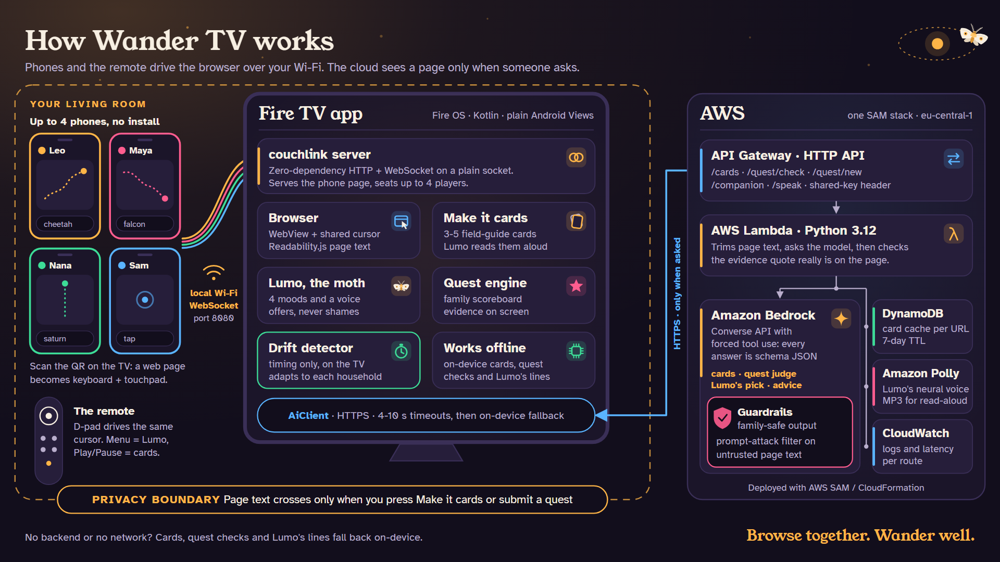

<p align="center">
  
</p>

# Wander TV

**A couch-first web browser for Fire TV. Every phone in the room becomes a keyboard and touchpad, and Lumo, a small moth who knows a thing or two about staring at bright screens, turns browsing into something the family does together.**

*Browse together. Wander well.*

Fire TV track · AWS Builder mini challenge · [Demo video](#demo-video) · [Download the APK](../../releases/latest) · [Devpost write-up](docs/DEVPOST.md) · [Architecture](#architecture)

---

## Why

The TV is the biggest, most shared screen in the house, and the worst one to browse on.

- **Typing with a remote is painful.** A URL or a search is entered one letter at a time on an on-screen keyboard.
- **The TV is shared, but browsers are single-user.** One cursor, one keyboard, one person holding the remote while everyone else says "no, click the other one".
- **Big screens invite aimless scrolling.** Page after page, nobody is looking for anything anymore. A moth circling a lamp knows the feeling.

Wander rebuilds the browser around the couch: everyone can drive, long pages become something the room can read, curiosity becomes a family game, and a gentle companion notices when the room starts circling.

## What it does

| | |
|---|---|
| 📱 **Every phone is a controller** | Scan the QR code on the TV and a web page opens on your phone: keyboard, touchpad, Back and Home. No app to install. Up to 4 phones join, each with a name and a color, and the shared cursor wears the color of whoever moved it last. |
| 💡 **Lumo, the moth** | A companion in the corner with four moods (curious, happy, sleepy, concerned), a speech bubble and a voice. Warm, short, a little funny. Lumo never shames anyone; it offers. |
| 🃏 **Make it cards** | One press turns a long article into 3-5 big field-guide cards the whole room can read from the couch. Flip with left and right. |
| 🐆 **Family quests, judged by AI** | "Speed Safari: find three animals faster than a car on the highway." Everyone races on their own phone and submits a page. Lumo checks it with AWS and shows the sentence from the page that proves it, on screen. |
| 😴 **Drift rescue that adapts** | Rapid page-hopping, endless scrolling, site loops and late nights make Lumo sleepy. It offers a quest or a curious detour. Every "we're fine" makes it more patient with your household. |
| 🔊 **Read aloud** | Lumo reads cards out loud with Amazon Polly, and falls back to the TV's own text-to-speech. |
| 🌙 **Works offline** | No backend or no network? Cards, quest checks and Lumo's lines all have on-device fallbacks. |

## Demo video

**[FILL IN: YouTube link]** (2:50, narrated by Lumo, recorded on a real Fire TV). The script, voiceover lines and the capture/edit pipeline are in [video/](video/SCRIPT.md).

## Screenshots

| | |
|---|---|
|  |  |
| **Home.** Four big tiles, Lumo, and the QR code that turns phones into controllers. | **The phone.** A web page served by the TV: touchpad, keyboard, Back, Home, cards and quest buttons. |
|  |  |
| **Make it cards.** A long page becomes 3-5 cards you can read from the couch. | **Family quest.** Every find shows the quote that proves it, plus who found it. |
|  | |
| **Drift rescue.** Lumo's line, the measured "why", and two ways out. | |

## Architecture



Phones and the remote drive the browser **locally**: the TV app runs a tiny HTTP + WebSocket server (couchlink) on port 8080, serves the phone page itself, and moves one shared cursor over a WebView. Nothing about the phones goes through the cloud.

The AI lives behind one AWS stack: **API Gateway (HTTP API) -> Lambda (Python 3.12) -> Amazon Bedrock** (Converse API with forced tool use, so every answer is schema-checked JSON) guarded by **Bedrock Guardrails** (family-safe content plus a prompt-attack filter on the untrusted page text), with **DynamoDB** caching cards per URL (7-day TTL), **Amazon Polly** giving Lumo a voice, and **CloudWatch** logs. The TV talks to it through `AiClient`, which has a timeout on every call and falls back to the on-device engine (`OfflineAi`) whenever the backend is slow, unset or failing.

## How it works

### Phones as controllers (couchlink)
The TV shows a QR code with its LAN address. The phone opens `http://<tv-ip>:8080/`, which the TV serves from `app/src/main/assets/phone/`, then connects to `ws://<tv-ip>:8080/ws`. Every message is a small JSON object (`hello`, `move`, `tap`, `scroll`, `go`, `type`, `key`, `cards`, `quest_submit`, `read`, `rescue`, `zoom`). The TV answers with `welcome`, `players` and a `state` snapshot so each phone shows the controls that fit the current screen. Up to 4 players; a phone that drops out rejoins with the same score and color. The server is **couchlink**, a zero-dependency HTTP/1.1 + WebSocket (RFC 6455) server on a plain `ServerSocket`, small enough for Fire OS 6 and testable on a desktop JVM.

### The remote still works
Nobody needs a phone. In the browser the D-pad moves the same cursor (it accelerates when held and scrolls the page at the edges).

| Key | Home | Browse | Cards | Quest screens | Rescue |
|---|---|---|---|---|---|
| D-pad | move focus | move cursor | flip | move focus | move focus |
| Center | open | tap at cursor | read card aloud | choose | choose |
| Back | exit | page back, then Home | close cards | close | "we're fine" |
| Menu (≡) | Lumo panel | Lumo bar: Make cards / Submit to quest / Home / Zoom | close | - | - |
| Rewind / Fast-fwd | - | page up / down | prev / next | - | - |
| Play/Pause | - | Make it cards | read aloud | - | - |

### Make it cards
Mozilla Readability runs inside the WebView and pulls out the readable text (capped at about 6,000 characters). `POST /cards` asks Bedrock for 3-5 cards (title up to 32 characters, one line up to 110, one emoji), cached in DynamoDB by URL so a popular article is only summarized once a week. Offline, a simpler on-device version builds the cards from the page's own structure.

### Family quests with evidence
Five curated quests (Speed Safari 🐆, Moon Collectors 🪐, Deep Dive 🐙, Time Travelers 🦕, Tiny Titans 🐜) plus **Lumo's pick**, a quest generated from the titles of pages the family visited tonight. A player hits *Submit* on their phone; `POST /quest/check` sends the quest rubric and the page text. The model must return a verdict **and a near-verbatim quote from the page**; the Lambda checks that the quote really is on the page before a pass counts, so the judge can't invent evidence. The quote appears on the TV next to the find. Scoring: 100 points per new item, +50 to whoever completes the quest; duplicates score 0 and Lumo says who found it first. Offline, an on-device judge matches each quest's accepted items and qualifying numbers.

### Drift rescue that learns your household
`DriftDetector` runs on the TV and sees **timing only**: page loads, dwell time, scrolling without clicks, how often the same site reopens, and the local hour. No URLs, no page text.

| Signal | Normal | Demo mode |
|---|---|---|
| Rapid hopping | 6+ pages in 5 min, each viewed under 20 s | 4+ pages in 60 s |
| Endless scroll | 3+ min of scrolling with no click | 45 s |
| Site loop | same site opened 5+ times in 15 min | 3 times in 3 min |
| Late night | after 23:00 with a session over 30 min | off |

When one fires, Lumo gets sleepy and offers two ways out: a quest or a curious detour (from `/companion`, or from Lumo's local line bank offline). Pressing Back means "we're fine": that rule's thresholds grow by 25% (up to 3x) and are saved on the TV, so a household that likes to hop gets fewer nudges. Accepting a suggestion nudges the thresholds back toward normal. Nudges can be switched off in the Lumo panel.

### Lumo's voice
`POST /speak` returns an MP3 from a neural Amazon Polly voice and the TV plays it. If the backend is unreachable, Android's on-device TextToSpeech reads instead.

## Privacy

> **Page text leaves the TV only when someone presses "Make it cards" or submits a quest answer.** Drift detection runs on the TV from timing alone. "Lumo's pick" sends recent page titles only when someone asks for it.

- The phones talk to the TV over your own Wi-Fi. There is no cloud relay, no account and no phone app.
- The backend is behind a shared key, and untrusted page text passes through Bedrock Guardrails' prompt-attack filter before the model acts on it.
- Generated cards are cached by page URL for 7 days, then expire automatically (DynamoDB TTL).

## Tech stack

| Part | Choice | Why |
|---|---|---|
| TV app | Kotlin, plain Android Views + Canvas, minSdk 25 | Runs on every Fire OS stick from Fire OS 6; no UI framework to fight on old devices |
| Browser | Android WebView + injected JS (Mozilla Readability, `wander-bridge.js`) | Real web pages, clean text for cards and quests |
| Phone controller | One HTML/CSS/JS page served by the TV | No install, works on any phone browser |
| LAN server | couchlink: zero-dependency HTTP + WebSocket (pure JVM) | Tiny, no Ktor/Netty, unit-testable on a desktop JVM |
| QR code | ZXing core | Pure Java, no Play Services |
| API | Amazon API Gateway HTTP API | Cheap, simple routes, shared-key header |
| Compute | AWS Lambda, Python 3.12, boto3 only | No dependencies to package |
| AI | Amazon Bedrock Converse API with forced tool use | Model is an env var; every answer is JSON in a fixed schema |
| Safety | Amazon Bedrock Guardrails | Family-safe output, prompt-attack filter on page text |
| Cache | Amazon DynamoDB with TTL | Cards per URL, expire after 7 days |
| Voice | Amazon Polly (neural) | Lumo reads cards aloud |
| Infra | AWS SAM / CloudFormation, Amazon CloudWatch | One-command deploy, logs per route |
| Type | Young Serif, Atkinson Hyperlegible | A warm display face, and a body face designed for low-vision readers |
| Tests | JUnit, Robolectric (native graphics), Python tests for the Lambda | UI checked as 1920x1080 PNGs without a device |

## Quick start for judges

You need a Fire TV that runs **Fire OS** (for example Fire TV Stick 4K or 4K Max) and a computer with `adb` ([Android platform-tools](https://developer.android.com/tools/releases/platform-tools)). Fire TV models that run Vega OS (such as the Fire TV Stick 4K Select and the newest Fire TV Stick HD) can't install Android APKs.

1. **Turn on ADB on the Fire TV.** Settings > My Fire TV > About, then press Select on the device name 7 times to unlock Developer Options. Go back, open Developer Options and turn on ADB Debugging. Find the TV's IP under Settings > My Fire TV > About > Network.
2. **Get the APK.** Download `wander-tv.apk` from [GitHub Releases](../../releases/latest), or [build it](#build-from-source).
3. **Install it.**
   ```sh
   adb connect <fire-tv-ip>:5555      # accept the "Allow USB debugging?" prompt on the TV
   adb install -r wander-tv.apk
   ```
4. **Open Wander TV** from the Apps row on the Fire TV home screen (or `adb shell am start -n tv.wander/.MainActivity`).
5. **Scan the QR code** on the TV with a phone on the same Wi-Fi. Type "cheetah" on the phone, then press *Make it cards*. Open *Quests* and start Speed Safari.

If the APK was built without a backend URL, or the backend can't be reached, Wander runs fully on-device. To point it at a backend, see [runtime config](#runtime-config).

## Build from source

Requirements: **JDK 17+** (21 works), **Android SDK 35** with build-tools 36.0.0. Set `JAVA_HOME` and `ANDROID_HOME` (or `sdk.dir` in `local.properties`).

```sh
./gradlew :app:assembleDebug            # -> app/build/outputs/apk/debug/app-debug.apk
./gradlew :app:assembleRelease          # -> app/build/outputs/apk/release/app-release.apk (debug-signed so it sideloads)
adb install -r app/build/outputs/apk/debug/app-debug.apk
```

`tools/gw.sh` (bash) and `tools\gw.ps1` (PowerShell) wrap the Gradle wrapper with default `JAVA_HOME` / `ANDROID_HOME` paths for our build machine; on yours, set those variables and the wrappers use them. **Android Studio** works too: open the folder and run the `app` configuration on the Fire TV connected over `adb`.

## Deploy the backend

The AWS side is one SAM / CloudFormation stack in `backend/`; full steps are in [backend/README.md](backend/README.md). In short, with the AWS CLI configured, the SAM CLI installed and access to a Bedrock model in your region (default `eu-central-1`):

```powershell
.\backend\deploy.ps1 -WriteGradle
```

This deploys API Gateway, Lambda, the Guardrail, DynamoDB and the IAM roles, then writes `wander.apiUrl` and `wander.apiKey` into `gradle.properties` so the next APK build talks to your stack. Leave those two properties empty to build a fully offline APK.

## Runtime config

Point an installed app at a backend, or turn on demo mode, without rebuilding:

```sh
adb shell am start -n tv.wander/.MainActivity \
  --es api_url https://<api-id>.execute-api.eu-central-1.amazonaws.com \
  --es api_key <your-key> \
  --ez demo true
```

Settings persist on the TV. **Demo mode** shortens the drift thresholds so a rescue appears after about a minute of fast browsing; it can also be toggled in the Lumo panel (Menu on Home).

## Testing

```sh
./gradlew :app:testDebugUnitTest            # JVM + Robolectric tests, including screenshot tests
./gradlew :app:testDebugUnitTest --tests '*Home*'
./gradlew :couchlink:test                   # HTTP + WebSocket server tests
./gradlew :couchlink:runPhoneHarness        # phone page + simulated TV at http://localhost:8080
python -m pytest backend/tests              # Lambda handlers with stubbed AWS clients (see backend/README.md)
```

- **Screenshot tests.** Robolectric's native graphics mode renders the real TV views to 1920x1080 PNGs in `app/build/snaps/` (see `app/src/test/java/tv/wander/testing/Snap.kt`), so every screen can be checked without a device.
- **Phone harness.** `runPhoneHarness` serves the phone page with a simulated TV, so the controller can be tested in a desktop browser or on a phone pointed at your computer's IP.
- WebView doesn't render under Robolectric, so browse logic is tested as plain JVM code, and the real thing on a Fire TV.

## Project structure

```
app/                         Fire TV app (package tv.wander), Kotlin, plain Android Views
  src/main/java/tv/wander/
    MainActivity.kt          layers, mode machine, key routing
    home/                    home screen, favorites, Lumo action bar
    browse/                  WebView layer, shared cursor, injected scripts
    companion/               Lumo (Canvas-drawn moth), drift detector, line bank, Lumo panel
    rescue/                  the rescue offer
    cards/                   Make it cards
    quest/                   quest catalog, engine, overlays
    ai/                      AiClient (AWS) + OfflineAi (on-device fallbacks)
    speech/                  Narrator: Polly, then on-device TTS
    net/                     PhoneHub (phone protocol), LAN address, QR
    ui/                      design tokens, sounds, helpers
  src/main/assets/
    phone/                   the phone controller web app
    js/                      Readability.js + wander-bridge.js
    fonts/                   Young Serif, Atkinson Hyperlegible (also served to phones)
  src/test/                  JVM + Robolectric tests, screenshot harness
couchlink/                   zero-dependency HTTP + WebSocket server, plus a desktop phone harness
backend/                     SAM template, Lambda (Python), deploy scripts, tests
docs/                        architecture diagram + title/end cards (SVG, render-images.ps1), Devpost write-up, screenshots
video/                       demo video script, voiceover lines, capture + edit scripts
tools/                       Gradle wrappers for this machine
SPEC.md, PLAN.md             the build contract and the original plan
```

## Built with Claude Code

Wander was built with an agentic workflow in [Claude Code](https://www.anthropic.com/claude-code):

1. A human-written product plan ([PLAN.md](PLAN.md)) became a build contract ([SPEC.md](SPEC.md)): repo layout, ownership per package, frozen shared types and design tokens, the phone protocol and the backend API.
2. Parallel builder agents worked in separate git worktrees, one per area (TV shell, browser, companion, cards and quests, phone + couchlink, AWS backend, docs), each only touching the files it owned.
3. Because the build machine had no Fire TV emulator, agents checked their own screens through Robolectric screenshots at 1920x1080 and tested the phone page with the desktop harness.
4. A human integrated the branches, tested from the couch on a real Fire TV, and fed back what felt wrong ("focus ring too thin", "cursor too slow").

## Credits and licenses

- **Young Serif** by The Young Serif Project Authors (noirblancrouge), SIL Open Font License 1.1 ([license](app/src/main/assets/fonts/OFL-YoungSerif.txt))
- **Atkinson Hyperlegible** by the Braille Institute of America, Inc., SIL Open Font License 1.1 ([license](app/src/main/assets/fonts/OFL-Atkinson.txt))
- **Mozilla Readability** (`app/src/main/assets/js/Readability.js`), Apache License 2.0
- **ZXing** core, Apache License 2.0
- Test-only dependencies (JUnit, Robolectric, org.json) keep their own licenses.

Fire TV, Fire OS, Amazon Appstore, Alexa, AWS and the AWS service names are trademarks of Amazon.com, Inc. or its affiliates. Wander TV is an independent hackathon project.

## License

MIT © 2026 Lucian Catalin Cojocaru. See [LICENSE](LICENSE).
